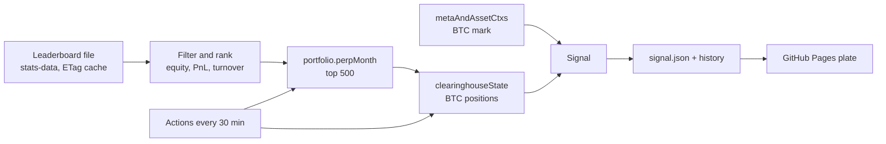

# Bitcoin positioning among Hyperliquid one-month leaders

[](LICENSE)
[](https://www.python.org/)
[](https://prafullj0shi.github.io/hyperliquid-btc-signal/)
[](https://github.com/PrafullJ0shi/hyperliquid-btc-signal/actions/workflows/sweep.yml)
[](https://prafullj0shi.github.io/hyperliquid-btc-signal/)

<p align="center">
  
</p>

A public, open-source instrument that answers one question: among the top 500 Hyperliquid traders ranked on **last-month perp PnL**, are their Bitcoin perpetual positions, on balance, long or short — and how concentrated is that weight?

The live plate is at [prafullj0shi.github.io/hyperliquid-btc-signal](https://prafullj0shi.github.io/hyperliquid-btc-signal/). The machine-readable snapshot is [`site/data/signal.json`](site/data/signal.json) (same file as [`data/signal.json`](data/signal.json)).

This is **not financial advice** and **not a forecast**. It is a descriptive reading of public positions at the issue time. It can be wrong. Do not trade on it.

<p align="center">
  
</p>

## What it measures

1. Download the public Hyperliquid leaderboard and keep it under an ETag cache.
2. Keep wallets with month PnL strictly greater than zero, account equity of at least $10,000, and month volume / equity of at most 100 (a turnover cap aimed at extreme market-maker-like flow; see below).
3. Take the top 700 of those by leaderboard month PnL and score them with the official `portfolio` endpoint. Rank by **perpMonth** PnL, keep those still above zero, and take the top 500.
4. Poll `clearinghouseState` for those 500 wallets (weight 2 each, under the official 1,200 weight/minute budget) and read their BTC positions.
5. Compute a weighted P(long), a 95% bootstrap interval, and a verdict.

## Algorithm

Each wallet \(i\) with a non-zero Bitcoin perpetual is a vote. Long is \(s_i = +1\), short is \(s_i = -1\). Wallets that are flat in BTC do not vote.

The skill, size, and conviction weight is

$$
w_i = \log\bigl(1 + \mathrm{PnL}_i^{\mathrm{perpMonth}}\bigr)
\cdot \min\bigl(1,\, E_i / 10^{5}\bigr)
\cdot \min\bigl(|N_i^{\mathrm{BTC}}| / E_i,\, 3\bigr)
$$

where \(E_i\) is account equity (USD) and \(N_i^{\mathrm{BTC}}\) is the Bitcoin position notional (USD). Equity below $100,000 shrinks the vote toward zero. Conviction is BTC notional over equity, capped at 3.

The headline probability is the share of that weight on the long side:

$$
P(\mathrm{long})
= \frac{\sum_{s_i=+1} w_i}{\sum_{s_i=+1} w_i + \sum_{s_i=-1} w_i}
$$

If the denominator is zero (no BTC votes), the verdict is NEUTRAL and \(P(\mathrm{long})\) is undefined.

The interval shown on the plate is a **95% bootstrap percentile interval**: traders are resampled with replacement 5,000 times (seed 42), \(P(\mathrm{long})\) is recomputed, and the 2.5th and 97.5th percentiles are reported. As a robustness check the snapshot also stores an equal-tailed interval from the unweighted Beta posterior

$$
\theta \sim \mathrm{Beta}\bigl(1 + n_{\mathrm{long}},\, 1 + n_{\mathrm{short}}\bigr).
$$

The decision rule, applied to the point estimate, is

$$
\text{verdict}
=
\begin{cases}
\mathrm{LONG} & \text{if } P(\mathrm{long}) \ge 0.60 \\
\mathrm{SHORT} & \text{if } P(\mathrm{long}) \le 0.40 \\
\mathrm{NEUTRAL} & \text{otherwise.}
\end{cases}
$$

When the bootstrap interval includes 0.5, the plate states that the point verdict is weakly held.

## Architecture



<p align="center">
  
</p>

A GitHub Actions workflow runs the Python sweep on a 30-minute cron (and on manual dispatch). The heavier `portfolio` ranking is reused for up to an hour. The workflow writes `data/signal.json`, deploys the `site/` directory to GitHub Pages, and commits the snapshot so the sparkline has a history. No paid API and no private node are required.

## How to run it locally

Python 3.11 or newer, then:

```bash
python3 -m venv .venv
.venv/bin/pip install -r requirements.txt
.venv/bin/python -m app.sweep          # first run rebuilds the cohort (about 10–15 min)
.venv/bin/python -m app.sweep          # later runs inside the hour skip portfolio
```

Serve the plate:

```bash
.venv/bin/pip install -r requirements.txt   # includes uvicorn
.venv/bin/python -m app.main                # http://127.0.0.1:8000/
# or:  python3 -m http.server 8000 --directory site --bind 127.0.0.1
```

`GET /api/signal` and `GET /api/history` are served by the local FastAPI process. The public site is static and only needs `site/data/signal.json`.

Unit tests (no network):

```bash
.venv/bin/pytest -q
```

## Filters, rate limits, and cadence

| Rule | Value | Why |
| --- | --- | --- |
| Minimum equity | $10,000 | Drops dust accounts. |
| Month PnL | strictly greater than 0 | The cohort is last month’s winners, not lifetime. |
| Turnover cap | month volume / equity \(\le 100\) | In a 24 Nov 2026 snapshot, wallets at 117–217× turnover looked market-maker-like; a named discretionary trader sat near 94×. 100 is a heuristic, not a perfect filter. |
| Ranking field | `portfolio` window `perpMonth` | The raw leaderboard month PnL is not perp-only (spot and other PnL can dominate, sometimes with near-zero volume). |
| Candidate pool | 700, then 500 | Extra names backfill wallets whose perp month PnL is not positive. |
| Info API budget | 1,200 weight / minute / IP | `portfolio` weighs 20; `clearinghouseState` and `allMids` weigh 2. The sweep uses a token bucket and backs off on HTTP 429. |
| Actions | every 30 minutes | A full 700-wallet `portfolio` pass is about ten to fifteen minutes, which would overlap a 15-minute cron. Portfolio is refreshed at most hourly. |

The leaderboard is the undocumented public file [https://stats-data.hyperliquid.xyz/Mainnet/leaderboard](https://stats-data.hyperliquid.xyz/Mainnet/leaderboard) (about 38 MB, typically close to hourly). It is cached with `If-None-Match`. All other reads are official `POST https://api.hyperliquid.xyz/info` requests.

## Limitations

- Public positions are not a trading signal. They can be hedges, inventory, or copy-flow.
- The turnover cap will admit some market makers and exclude some active discretionary traders.
- Leaderboard and `portfolio` windows are not intra-minute. Positions are polled more often than the cohort is rebuilt.
- `userFills` is not used in the MVP (it is too heavy to poll for 500 wallets every half hour). Win rates are not part of the weight.
- The bootstrap interval treats wallets as independent. They are not.
- A WebSocket cannot subscribe to 500 users from one IP (the official cap is 10 unique users). This project polls REST.
- GitHub Actions shares a datacenter IP; 429s will slow a run. The job is allowed 40 minutes.
- Past snapshots can be used later to ask how often the verdict preceded a favourable BTC move. That calibration is not claimed here.

## License

MIT, Copyright (c) 2026 Prafull Joshi. IBM Plex fonts are included under the SIL Open Font License (see `site/fonts/OFL.txt`).
