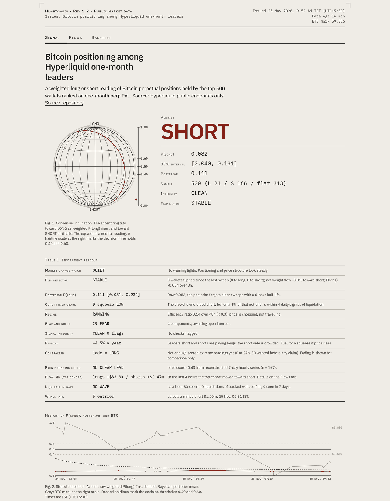
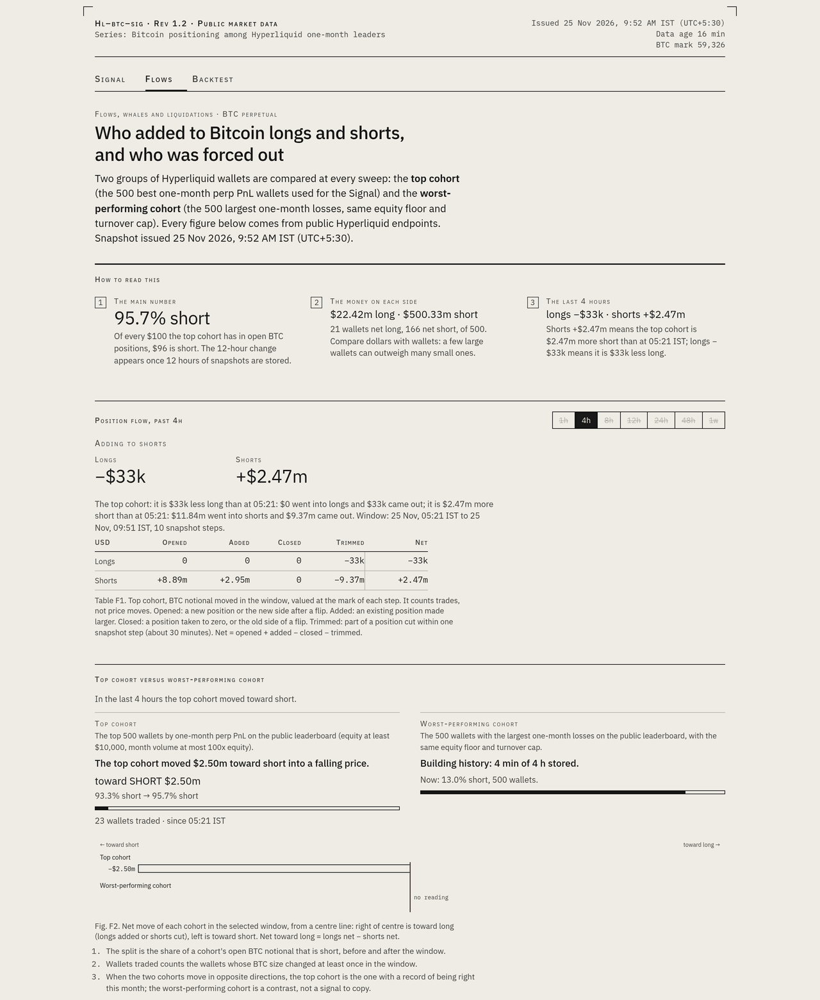
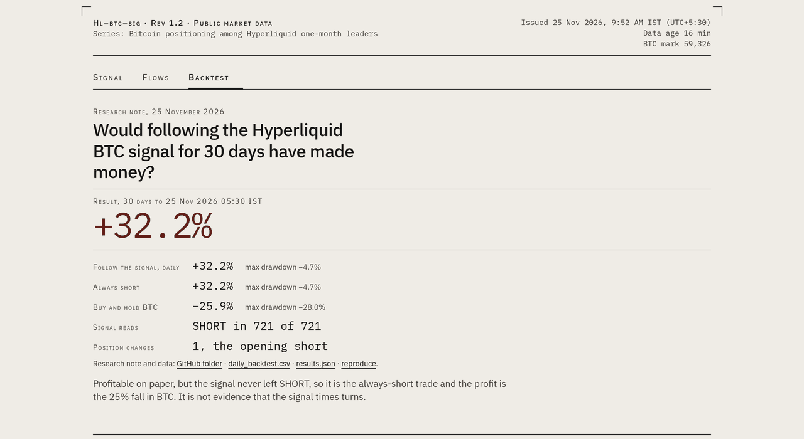
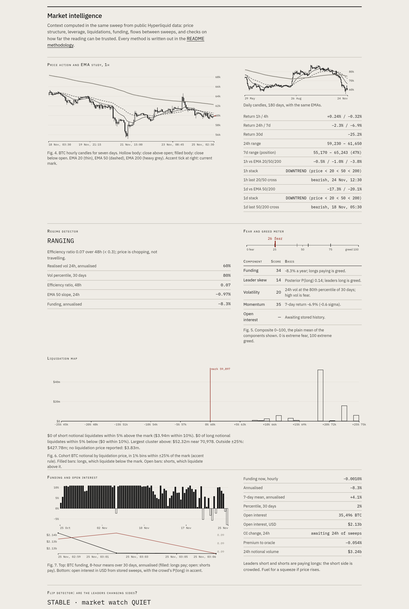
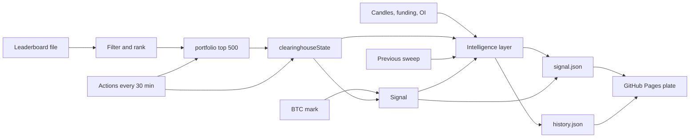
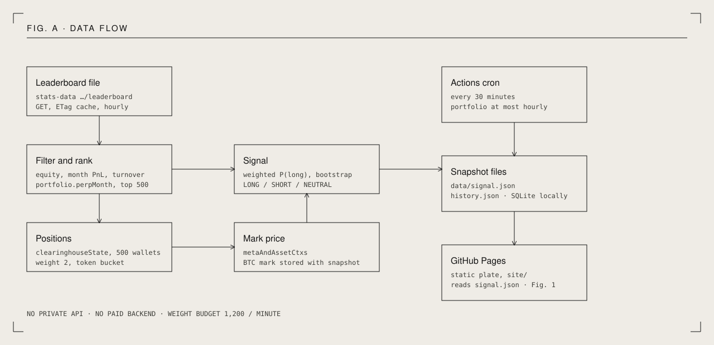

# Bitcoin positioning among Hyperliquid one-month leaders

[](LICENSE)
[](https://github.com/PrafullJ0shi/hyperliquid-btc-signal/actions/workflows/sweep.yml)
[](https://prafullj0shi.github.io/hyperliquid-btc-signal/)
[](https://www.python.org/)
[](https://prafullj0shi.github.io/hyperliquid-btc-signal/)

<p align="center">
  
</p>

A public, open-source instrument that answers one question: among the top 500 Hyperliquid traders ranked on **last-month perp PnL**, are their Bitcoin perpetual positions, on balance, long or short — and how concentrated is that weight?

The live plate is at [prafullj0shi.github.io/hyperliquid-btc-signal](https://prafullj0shi.github.io/hyperliquid-btc-signal/). It has three tabs: **Signal**, **Flows**, and **Backtest**. The machine-readable snapshot is [`site/data/signal.json`](site/data/signal.json) (same file as [`data/signal.json`](data/signal.json)).

This is **not financial advice** and **not a forecast**. It is a descriptive reading of public positions at the issue time. It can be wrong. Do not trade on it.

## Contents

- [What it shows](#what-it-shows)
- [Quick start](#quick-start)
- [Methodology](#methodology)
- [Flows, whales and liquidations](#flows-whales-and-liquidations)
- [Research: 30-day backtest](#research-30-day-backtest)
- [Limits](#limits)
- [Upcoming: v2.0](#upcoming-v20)
- [V2 roadmap: product and developer track](#v2-roadmap-product-and-developer-track)
- [Architecture](#architecture)
- [Filters, rate limits, and cadence](#filters-rate-limits-and-cadence)
- [License](#license)
- [Disclaimer](#disclaimer)
- [Changelog](CHANGELOG.md) · [Contributing](CONTRIBUTING.md) · [v2.0 plan](docs/ROADMAP.md)

## What it shows

**Signal.** A weighted P(long), a 95% bootstrap interval, and a verdict (LONG at or above 0.60, SHORT at or below 0.40, otherwise NEUTRAL). Around that reading sits a market-intelligence layer: cohort risk grades, a liquidation map, a flip detector, a position-change feed, the history of P(long), price action and EMAs, a regime detector, a fear and greed meter, funding and open interest, a fake-signal detector, contrarian mode, a reconstructed backtest, a lead-lag study, and a front-running meter. An X sentiment panel is reserved for [v2.0](#upcoming-v20).

<p align="center">
  
</p>

**Flows.** Who added to Bitcoin longs and shorts in the last hours, and who was forced out: a past-4-hour flow box (opened, added, closed, trimmed) with 1h to 1w timeframes, the top cohort set against the worst-performing cohort, a whale tape with orders worked over time, and sampled liquidations with a wave detector. Method: [Flows, whales and liquidations](#flows-whales-and-liquidations).

<p align="center">
  
</p>

**Backtest.** A reconstructed 30-day study asks whether following the signal would have made money after fees and funding, and states the result next to the reasons it is not evidence of an edge. Write-up: [`research/backtest-30d/README.md`](research/backtest-30d/README.md) and the [Backtest tab](https://prafullj0shi.github.io/hyperliquid-btc-signal/#backtest).

<p align="center">
  
</p>

The method for every live reading is under [Methodology](#methodology). Screenshots are from a 25 November 2026 issue of the plate and will lag the live numbers.

## Quick start

Python 3.11 or newer, then:

```bash
python3 -m venv .venv
.venv/bin/pip install -r requirements.txt
.venv/bin/python -m app.sweep          # first run rebuilds the cohort (about 10–15 min)
.venv/bin/python -m app.sweep          # later runs inside the hour skip portfolio
```

Serve the plate:

```bash
.venv/bin/pip install -r requirements.txt   # includes uvicorn
.venv/bin/python -m app.main                # http://127.0.0.1:8000/
# or:  python3 -m http.server 8000 --directory site --bind 127.0.0.1
```

`GET /api/signal` and `GET /api/history` are served by the local FastAPI process. The public site is static and only needs `site/data/signal.json`.

Unit tests (no network):

```bash
.venv/bin/pytest -q
```

## Methodology

How the live readings are built, from the cohort and the weighted vote through the market-intelligence layer. Flows are documented separately under [Flows, whales and liquidations](#flows-whales-and-liquidations).

### What it measures

1. Download the public Hyperliquid leaderboard and keep it under an ETag cache.
2. Keep wallets with month PnL strictly greater than zero, account equity of at least $10,000, and month volume / equity of at most 100 (a turnover cap aimed at extreme market-maker-like flow; see below).
3. Take the top 700 of those by leaderboard month PnL and score them with the official `portfolio` endpoint. Rank by **perpMonth** PnL, keep those still above zero, and take the top 500.
4. Poll `clearinghouseState` for those 500 wallets (weight 2 each, under the official 1,200 weight/minute budget) and read their BTC positions.
5. Compute a weighted P(long), a 95% bootstrap interval, and a verdict.

### Algorithm

Each wallet $i$ with a non-zero Bitcoin perpetual is a vote. Long is $s_i = +1$, short is $s_i = -1$. Wallets that are flat in BTC do not vote.

The skill, size, and conviction weight is

$$
w_i = \log\bigl(1 + \mathrm{PnL}_i^{\mathrm{perpMonth}}\bigr)
\cdot \min\bigl(1,\, E_i / 10^{5}\bigr)
\cdot \min\bigl(|N_i^{\mathrm{BTC}}| / E_i,\, 3\bigr)
$$

where $E_i$ is account equity (USD) and $N_i^{\mathrm{BTC}}$ is the Bitcoin position notional (USD). Equity below USD 100,000 shrinks the vote toward zero. Conviction is BTC notional over equity, capped at 3.

The headline probability is the share of that weight on the long side:

$$
P(\mathrm{long})
= \frac{\sum_{s_i=+1} w_i}{\sum_{s_i=+1} w_i + \sum_{s_i=-1} w_i}
$$

If the denominator is zero (no BTC votes), the verdict is NEUTRAL and $P(\mathrm{long})$ is undefined.

The interval shown on the plate is a **95% bootstrap percentile interval**: traders are resampled with replacement 5,000 times (seed 42), $P(\mathrm{long})$ is recomputed, and the 2.5th and 97.5th percentiles are reported. As a robustness check the snapshot also stores an equal-tailed interval from the unweighted Beta posterior

$$
\theta \sim \mathrm{Beta}\bigl(1 + n_{\mathrm{long}},\, 1 + n_{\mathrm{short}}\bigr).
$$

The decision rule, applied to the point estimate, is:

- LONG if $P(\mathrm{long}) \ge 0.60$
- SHORT if $P(\mathrm{long}) \le 0.40$
- NEUTRAL otherwise.

When the bootstrap interval includes 0.5, the plate states that the point verdict is weakly held.

<p align="center">
  
</p>

Notation: $p_t$ is the weighted P(long) at sweep $t$, $m_t$ the BTC mark, $\sigma_d$ the daily BTC volatility (standard deviation of hourly log returns over 7 days, times $\sqrt{24}$). Every number below is written to `data/signal.json` under `intel`; the field is named in brackets.

### 1. Cohort risk grade `[intel.risk]`

For each wallet with a BTC position, effective leverage is gross notional over equity, $L_i = \mathrm{totalNtlPos}_i / E_i$, and daily account volatility is approximated as $v_i = L_i \sigma_d$ (all exposure treated as moving with BTC, a conservative simplification).

Distance to liquidation, as a fraction of the mark, is $d_i = (m - \ell_i)/m$ for a long and $d_i = (\ell_i - m)/m$ for a short, where $\ell_i$ is the reported liquidation price. In sigma units, $z_i = d_i / \sigma_d$.

| Grade | $z_i$ (liquidation distance in daily sigmas) | $v_i$ (daily account volatility) |
| --- | --- | --- |
| A | at least 10, or no liquidation price | under 5% |
| B | 6 to 10 | 5% to 10% |
| C | 4 to 6 | 10% to 20% |
| D | 2.5 to 4 | 20% to 35% |
| F | under 2.5 | 35% or more |

A wallet's grade is the worse of the two columns. The aggregate grade is the notional-weighted mean on a 4-3-2-1-0 scale (A to F), mapped back to a letter.

**Squeeze warning.** Let skew $= |2p_t - 1|$ and let $q$ be the share of the dominant side's notional with $z_i < 4$. Squeeze risk is ELEVATED when skew $\ge 0.5$ and $q \ge 0.10$, and HIGH when skew $\ge 0.7$ and $q \ge 0.25$. Otherwise it is LOW.

### 2. Liquidation map `[intel.liquidation_map]`

Each position's liquidation price is placed in 1% bins of $\ell_i / m - 1$ within ±25%, and its BTC notional is summed per bin and side. Longs liquidate below the mark, shorts above it. The plate also reports cumulative notional within 5% and 10% each way, the largest cluster on each side, and notional beyond ±25% or with no liquidation price (common for low-leverage cross accounts).

### 3. Flip detector and market-change watch `[intel.flip]`, `[intel.market_watch]`

Each sweep stores every wallet's signed BTC size $s_i$ in `data/cohort.json`. On the next sweep, for wallets present both times, the net weight flow is

$$
F_t = \frac{\sum_i \left( \mathrm{sgn}(s_i^{t}) w_i^{t} - \mathrm{sgn}(s_i^{t-1}) w_i^{t-1} \right)}{\sum_i w_i^{t}}
$$

with both weights computed from current PnL and equity, so only size and side changes move it. Momentum is $\Delta_{3h} = p_t - p_{t-3h}$ and $\Delta_{24h} = p_t - p_{t-24h}$ (nearest stored snapshot).

- TURNING if $|\Delta_{3h}| \ge 0.12$, or $|F_t| \ge 0.10$, or net flips are at least 5% of voters.
- DRIFTING if $|\Delta_{3h}| \ge 0.05$, or $|F_t| \ge 0.04$, or net flips are at least 2% of voters.
- STABLE otherwise. The direction is the sign of $\Delta_{3h} + F_t$.

The market-change watch counts independent warning lights: the flip status is not STABLE; $p_t$ lies within 0.05 of a decision threshold; the regime is HIGH-VOL; the regime changed since the last sweep; squeeze risk is ELEVATED or HIGH; funding is beyond ±30% a year; an EMA 20/50 cross happened on 1h candles in the last 12 hours. None lit is QUIET, one or two is WATCH, three or more is ALERT.

### 4. Position-change feed `[intel.changes]`

Each compared wallet is classified as OPEN (flat to positioned), CLOSE, FLIP (side change), ADD, or CUT (same side, size changed by at least 10% and USD 50,000). The feed lists the 15 largest by $|\Delta s_i| \cdot m$. Wallets that joined or left the cohort between sweeps are counted as churn, not as trades.

### 5. History of P(long) `[data/history.json]`

One compact row per sweep, newest last, capped at 1,440 rows (30 days at 30 minutes). Each row holds $p_t$, the posterior mean, the interval, the mark, hourly funding, open interest, the fear and greed score, regime, flow, flips, aggregate grade, and integrity status.

### 6. Price action and EMA study `[intel.price_action]`, `[intel.ema]`

From `candleSnapshot`, the exponential moving average with span $n$ is

$$
\mathrm{EMA}_t = \alpha c_t + (1-\alpha)\,\mathrm{EMA}_{t-1}, \qquad \alpha = \frac{2}{n+1},
$$

seeded with the simple mean of the first $n$ closes. Spans 20, 50, and 200 are computed on 1h candles (35 days) and 1d candles (400 days). The stack label is UPTREND when price > EMA20 > EMA50 > EMA200, DOWNTREND for the reverse order, otherwise "above 200, mixed" or "below 200, mixed". Crosses are the last sign change of EMA20 − EMA50 and EMA50 − EMA200. Returns over 1h, 4h, 24h, 7d, and 30d and the position inside the 7-day range are shown beside the chart.

### 7. Regime detector `[intel.regime]`

Realised volatility over 24 hours, annualised, is

$$
\mathrm{RV}_{24} = \mathrm{sd}\left(\ln c_t - \ln c_{t-1}\right) \sqrt{24 \cdot 365}.
$$

Its percentile $\pi$ is taken against every rolling 24-hour window in the last 35 days. The Kaufman efficiency ratio over 48 hours is

$$
\mathrm{ER} = \frac{|c_t - c_{t-48}|}{\sum_{k=1}^{48} |c_{t-k+1} - c_{t-k}|} \in [0, 1].
$$

- HIGH-VOL if $\pi \ge 0.85$, labelled panic when the 24-hour return is negative and euphoria otherwise.
- TRENDING if $\mathrm{ER} \ge 0.30$, with the direction from the 24-hour slope of the 1h EMA50.
- RANGING otherwise. Funding beyond ±30% a year adds a crowding note.

### 8. Fear and greed meter `[intel.fear_greed]`

The score is the plain mean of the available components, each on 0 to 100 (100 is greed):

| Component | Formula |
| --- | --- |
| Funding | $50 + 50 \tanh(f_{\mathrm{ann}} / 0.25)$, where $f_{\mathrm{ann}}$ is the hourly rate times 8,760 |
| Leader skew | $100 \cdot \hat p_t$, the Bayesian posterior mean |
| Volatility | $100 (1 - \pi)$ |
| Momentum | $50 + 50 \tanh(z/2)$ with $z = r_{7d} / (\sigma_d \sqrt 7)$ |
| Open interest | $50 + 50 \tanh\left(\mathrm{sgn}(r_{24h}) \cdot \Delta \mathrm{OI}_{24h} / 0.05\right)$, once 24 hours of sweeps are stored |

Bands: under 25 extreme fear, 25 to 44 fear, 45 to 55 neutral, 56 to 75 greed, above 75 extreme greed. A missing component is left out, not imputed.

### 9. X sentiment `[intel.x_sentiment]`

Reserved for v2.0 (see [Upcoming: v2.0](#upcoming-v20) and [docs/ROADMAP.md](docs/ROADMAP.md)). The sweep never calls X. If a valid `data/x_sentiment.json` exists (`ts_utc`, `n_posts`, and `score` in $[-1, 1]$ required; `window_hours`, `bull_share`, `bear_share`, `method` optional), it is passed through; otherwise the panel shows its planned state and no numbers.

### 10. Contrarian mode `[intel.contrarian]`

The faded reading is the opposite verdict with $1 - p_t$. A reading is extreme when $p_t \le 0.15$ or $p_t \ge 0.85$. From the accuracy tracker, the fade hit rate at 24 hours is the share of extreme readings followed by a move against the crowd. Fading is argued for only when at least 30 extreme readings have been scored and the fade hit rate exceeds 0.55. Until then the panel says the evidence is insufficient.

### 11. Fake-signal detector `[intel.integrity]`

With weight shares $u_i = w_i / \sum_j w_j$, the Herfindahl index is $\mathrm{HHI} = \sum_i u_i^2$ and the effective number of voters is $N_{\mathrm{eff}} = 1/\mathrm{HHI}$. Eight checks, each flagged on a fixed rule:

| Check | Flag when |
| --- | --- |
| Effective voters | $N_{\mathrm{eff}} < 10$ |
| Top-5 weight share | above 50% |
| Leave-top-5-out | the verdict changes when the five heaviest wallets are removed |
| Interval width | bootstrap width above 0.30, or the interval spans 0.50 |
| Participation | fewer than 50 voters, or under 15% of the cohort |
| Hedger / MM-like weight | over 30% of weight from wallets whose other perps offset at least 70% of their BTC notional, or whose month turnover is at least 50× equity |
| Count vs weight | head-count share and weighted share fall on opposite sides of 0.50 |
| Data age | the snapshot is older than two hours (re-checked in the browser) |

Status is CLEAN with no flags, CAUTION with one or two, SUSPECT with three or more.

### 12. Funding and open interest `[intel.funding_oi]`

Hourly funding comes from `fundingHistory` (30 days, shown as 8-hour means) and the live rate, open interest, and premium from `metaAndAssetCtxs`. Open interest history accrues one point per sweep in `history.json`. The combined reading crosses the crowd's verdict with the funding sign: leaders short while shorts pay funding means a crowded short side (squeeze fuel); leaders short while longs pay means leaders lean against the market, and the mirror cases for LONG.

### 13. Bayesian updating `[intel.bayes]`

An exponentially forgotten Beta-Binomial. Each sweep contributes $K_t = \min(N_{\mathrm{eff}}, 50)$ pseudo-observations split by $p_t$, and older evidence decays with a six-hour half-life:

$$
A_t = \lambda_t A_{t-1} + (1-\lambda_t) K_t p_t, \qquad B_t = \lambda_t B_{t-1} + (1-\lambda_t) K_t (1-p_t), \qquad \lambda_t = 2^{-\Delta t / 6\,\mathrm{h}}
$$

$$
\theta_t \sim \mathrm{Beta}(1 + A_t,\; 1 + B_t)
$$

The total pseudo-count tends to $K_t$, so repeated looks at the same positions do not manufacture certainty. The posterior is replayed from `history.json` each sweep, so it needs no hidden state. Rows stored before $N_{\mathrm{eff}}$ was recorded use $K = 25$. The plate shows the posterior mean, the 95% equal-tailed credible interval, $P(\theta > 0.5)$, and the gap between raw and posterior.

### 14. Backtesting `[intel.accuracy]`, `[intel.backtest]`

**Live accuracy tracker.** Each stored verdict at time $t$ is scored against the BTC price at $t+h$ for $h \in \{1, 4, 24\}$ hours, taken from the 15-minute candle containing $t+h$ (or the nearest stored mark within 20 minutes). Let $y = 1$ if price rose. Below, the denominator counts LONG and SHORT verdicts, and the numerator counts LONG verdicts followed by a rise plus SHORT verdicts followed by a fall:

$$
\text{hit rate} = \frac{n_{L,1} + n_{S,0}}{n_L + n_S}, \qquad \mathrm{BS} = \frac{1}{n}\sum (p_t - y)^2
$$

Brier scores are reported for the raw P(long) and the posterior, beside a coin (0.25) and the climatology baseline $\bar y(1-\bar y)$. Because snapshots are 30 minutes apart, rows overlap at 4h and 24h; the table shows an approximate independent count, the scored span divided by the horizon.

**Reconstructed seven-day backtest.** Once a day, the 30 wallets with the largest potential weight (skill times equity shrink) are read with `userFills` (latest 2,000 fills each). Each BTC fill carries its `startPosition`, so the position after a fill is $s = s_{\mathrm{start}} \pm \mathrm{sz}$, and the position at any hour is the end position of the last fill before it. Where a wallet's 2,000 fills do not reach back seven days, it is treated as unknown before its earliest fill. Hourly P(long) is recomputed with today's PnL and equity, scored at 4h and 24h, and turned into a "follow the verdict" curve (long when LONG, short when SHORT, flat when NEUTRAL; no costs) against holding BTC.

### 15. Lead-lag study `[intel.lead_lag]`

With $x_t = p_t - p_{t-1}$ and $y_t = \ln m_t - \ln m_{t-1}$ on a regular grid (30 minutes for live snapshots, 1 hour for the reconstructed series), the cross-correlation is

$$
r_k = \mathrm{corr}(x_t,\; y_{t+k}), \qquad k = -6, \dots, 6.
$$

Positive $k$ means the leaders' positioning changed first. The noise band is $\pm 1.96 / \sqrt{n}$. Gaps are skipped pairwise.

### 16. Front-running meter `[intel.front_running]`

$$
S = \frac{\sum_{k>0} r_k^2 - \sum_{k<0} r_k^2}{\sum_{k \ne 0} r_k^2} \in [-1, 1]
$$

$S > 0.2$ reads as FRONT-RUNNING (changes come before price moves) and $S < -0.2$ as CHASING, but only if the largest $|r_k|$ at a non-zero lag clears the noise band; otherwise the label is NO CLEAR LEAD. The live series is used once it has at least 30 paired steps; until then the reconstructed series is used and named. A companion number is the share of non-zero flows followed by a same-direction price move one hour (live) or four hours (reconstructed) later.

## Flows, whales and liquidations

The site's **Flows** tab ([live](https://prafullj0shi.github.io/hyperliquid-btc-signal/#flows)) answers four questions about Bitcoin perpetuals from the same public data: which way the money moved in the last few hours, whether the best and the worst traders moved the same way, which single wallets made large moves (including one large order worked over time), and whether a wave of liquidations is under way. Everything is in `intel.tracker` of [`data/signal.json`](data/signal.json); the code is in [`app/flow.py`](app/flow.py), [`app/tape.py`](app/tape.py) and [`app/tracking.py`](app/tracking.py). The coin is a parameter (`TRACK_COIN`), so other perpetuals can be added later.

### Two cohorts `[intel.tracker.cohorts]`

- **Top cohort** $\mathcal{T}$: the 500 wallets used for the Signal (best one-month perp PnL, equity at least USD 10,000, month volume at most 100 times equity).
- **Worst-performing cohort** $\mathcal{W}$: from the same leaderboard file, wallets with month PnL below zero, the same equity floor and turnover cap, sorted by month PnL from the largest loss, the first 500 not already in $\mathcal{T}$. It is a contrast group, labelled as such on the page, and is not ranked with `portfolio`, so its month PnL is whole-account rather than perp-only.

Both cohorts are polled with `clearinghouseState` at every sweep.

### Position flow `[intel.tracker.flow]`

For wallet $i$ present in two consecutive snapshots, let $p_i$ and $c_i$ be its signed BTC size before and after, and $m$ the BTC mark at the later snapshot. The change is split by side:

$$
O^{L}_i = c_i\,[p_i \le 0 < c_i], \qquad A^{L}_i = (c_i - p_i)\,[0 < p_i \le c_i], \qquad R^{L}_i = (p_i - c_i)\,[0 < c_i < p_i], \qquad X^{L}_i = p_i\,[c_i \le 0 < p_i]
$$

for opened, added, trimmed, and closed longs, where $[\cdot]$ is 1 when the condition holds and 0 otherwise. The short side is the mirror image with $|p_i|$ and $|c_i|$. A flip closes the old side in full and opens the new side in full. Dollar amounts are sizes times the mark, so a step **counts trades, not price moves**:

$$
O^{L} = m \sum_{i} O^{L}_i \quad \text{(and likewise for } A, R, X \text{ and the short side)}
$$

Wallets that joined or left a cohort between the two snapshots are left out of that step, and a wallet whose poll failed keeps its last known size, so a failed request is never read as a close. A window of $h$ hours sums every stored step after a baseline snapshot, chosen as the stored snapshot closest to $t - h$ and accepted only within $\max(25\ \mathrm{min},\ 0.15\,h)$ of it. Otherwise the timeframe button is disabled, and its note says why: too little history stored, or no sweep stored close enough to the window start (scheduled sweeps do not run at exact intervals).

$$
\Delta L = \sum_{s} \left(O^{L}_s + A^{L}_s - X^{L}_s - R^{L}_s\right), \qquad \Delta S = \sum_{s} \left(O^{S}_s + A^{S}_s - X^{S}_s - R^{S}_s\right), \qquad \mathrm{toward\ long} = \Delta L - \Delta S
$$

"Longs +18.37m" therefore means the cohort holds USD 18.37m more in longs than at the baseline because of trades in the window. The split shown before and after is the short share of open BTC notional,

$$
\sigma = \frac{N_{S}}{N_{L} + N_{S}},
$$

which does not depend on the price level because both sides are valued at the same mark. "Wallets traded" counts distinct wallets with any size change in the window. The headline sentence sets the net move against the BTC price change over the same window (flat if it is within 0.3%).

The step log (`flow_log` in `data/cohort.json`) keeps eight days, enough for the one-week window. It was seeded once by [`scripts/backfill_flow.py`](scripts/backfill_flow.py) from the per-wallet snapshots already stored in this repository's git history, which gives exactly the steps the live sweep would have computed; the worst-performing cohort has no stored snapshots before this release and builds its history from the first sweep.

### Whale tape `[intel.tracker.whales]`

Three kinds of entry, kept for seven days:

1. **Position change**: $|c_i - p_i|\,m \ge \mathrm{USD}\ 1{,}000{,}000$ between two snapshots. The entry shows the verb (opened, added to, trimmed, closed, flipped to), the size before and now, leverage and margin type, margin, the fill price, position PnL, the wallet's cohort rank, its all-time and 30-day leaderboard PnL, and a link to the wallet on the Hyperliquid explorer. The fill price is the volume-weighted price of the wallet's same-direction fills in the step, $\bar{P} = \sum_j P_j q_j / \sum_j q_j$; without fills, the snapshot mark is shown and labelled as such.
2. **Large order**: all fills sharing one order id with notional at least USD 1,000,000.
3. **Order worked over time**: either a native Hyperliquid TWAP (fills that carry a `twapId`, grouped by that id) or a TWAP-like pattern. A pattern is a maximal run of same-side orders $o_1, \dots, o_n$ from one wallet, with no opposite-side order between them and no pause above 45 minutes, that satisfies:

$$
n \ge 5, \qquad t_n - t_1 \ge 15\ \mathrm{min}, \qquad \sum_{j} N_j \ge \mathrm{USD}\ 1{,}000{,}000, \qquad \frac{\max_j N_j}{\sum_j N_j} \le 0.5,
$$

where $N_j$ is the notional of order $j$. The last condition keeps one big order with a few small ones from counting as a worked order. The entry reports the number of orders, duration, average price, median gap, and the taker share.

Fills come from `userFillsByTime` (four hours back), requested only for wallets whose BTC size moved by at least USD 25,000 since the previous snapshot, at most 50 wallets per sweep, largest moves first. Fills that carry a liquidation record are not counted as orders. A pattern whose fills are mostly taker fills is labelled "TWAP-like, taker slices"; one filled mostly by resting orders is labelled "passive accumulation, resting orders". The entry also names what the run did to the position by notional (for example, closing a short).

### Big liquidations and waves `[intel.tracker.liquidations]`

Hyperliquid's public info API has **no market-wide liquidation feed**. What can be measured is this: a fill that belongs to a liquidation carries a `liquidation` record naming the liquidated wallet. Such fills appear in a tracked wallet's history either because the tracked wallet was liquidated, or because its resting order absorbed someone else's liquidation. The liquidated side is the side being closed for the wallet's own fills; for a counterparty fill it is the opposite of the tracked wallet's side (a tracked buy means a long was being sold off). Fills are deduplicated by trade id and grouped per liquidated wallet and second. The seen notional is a **lower bound** on the liquidation. To widen the sample, each sweep also scans 16 tracked wallets that moved less: first up to 8 that absorbed BTC liquidations before, then a round-robin through both cohorts.

A **wave** is flagged when the last hour's seen notional is far above its recent norm:

$$
\bar{L} = \frac{\text{seen notional in the observed period before the last hour (up to 7 days)}}{\text{hours in that period}}, \qquad \mathrm{wave} \iff L_{1h} \ge \max\left(\mathrm{USD}\ 1{,}000{,}000,\ 5\,\bar{L}\right)\ \text{and}\ n_{1h} \ge 3.
$$

**Proxy, clearly labelled.** Open interest falling while price moves sharply is what a liquidation burst looks like from outside. For each pair of stored sweeps at most 75 minutes apart, with open interest $\mathrm{OI}$ in BTC and return $r$,

$$
\mathrm{flag} \iff \left(\frac{\mathrm{OI}_t}{\mathrm{OI}_{t-1}} - 1 \le -0.015\ \text{and}\ |r_t| \ge 0.01\right)\ \text{or}\ \left(z_{\mathrm{OI}} \le -3\ \text{and}\ |z_r| \ge 2\right), \qquad z = \frac{x - \mathrm{med}(x)}{1.4826\,\mathrm{MAD}(x)},
$$

where the robust z-scores use the previous steps of the last seven days and need at least 24 of them. A falling price marks longs as the likely side, a rising price shorts. The amount shown, $(\mathrm{OI}_{t-1} - \mathrm{OI}_t)\,m_t$, is an **upper bound**: voluntary closes also lower open interest.

### How to read the Flows tab

Each panel carries numbered notes on the page. The three at the top are: (1) the main number, the top cohort's short share of open BTC notional ("of every USD 100 in open positions, USD 64 is short") with its 12-hour change; (2) the money on each side, in dollars and in wallets, because a few large wallets can outweigh many small ones; (3) the last few hours: "shorts −10.86m" means the cohort is USD 10.86m less short than at the window's start.

## Research: 30-day backtest

Would following this signal for 30 days have made money? A reconstructed backtest rebuilds the hourly P(long) from the fills of 100 cohort wallets and trades one unit of BTC perp on it, with the 0.045% taker fee and the hourly funding.

| Rule, 30 days to 25 Nov 2026 05:30 IST | Return after fees and funding | Max drawdown |
| --- | ---: | ---: |
| Follow the signal, daily | +32.2% | −4.7% |
| Always short | +32.2% | −4.7% |
| Buy and hold BTC | −25.9% | −28.0% |

**Profitable on paper, not evidence of an edge.** The signal read SHORT in all 721 hourly reads, so following it was the same trade as being short all month while BTC fell 25.4%. The window held no reversal, so it says nothing about whether the signal can call a turn. The cohort is also last month's winners, which biases it toward the side that won.

- Research note, with every formula, the 30-row day-by-day table, the reasons and the caveats: [`research/backtest-30d/README.md`](research/backtest-30d/README.md)
- Same page on the site: [Backtest tab](https://prafullj0shi.github.io/hyperliquid-btc-signal/#backtest)
- Data: [`daily_backtest.csv`](research/backtest-30d/data/daily_backtest.csv), [`results.json`](research/backtest-30d/data/results.json), [`hourly_signal.csv`](research/backtest-30d/data/hourly_signal.csv)
- Reproduce: `python research/backtest-30d/scripts/analyze.py`

## Limits

- Everything here describes public positions. Positions can be hedges, inventory, collateral management, or copy-flow; none of it is a forecast.
- **Survivorship in the reconstructed backtest.** Wallets are chosen because they won last month, then their past positions are scored. That is biased upward by construction. Only the live accuracy tracker is out-of-sample, and it starts with this release.
- **Fill cap.** `userFills` returns at most the latest 2,000 fills (10,000 by time query). Active wallets cover only part of the seven days; coverage is reported.
- **Overlapping samples.** Scored rows at 4h and 24h overlap heavily. Hit rates and Brier scores from a few days of snapshots are noisy; the independent count is shown for that reason.
- **Risk grade approximations.** Account volatility treats all exposure as moving one-for-one with BTC. Cross-margin liquidation prices depend on the whole account and move as other positions move.
- **Market-maker detection is heuristic.** Without per-wallet order books, "hedged elsewhere" and "high turnover" are proxies.
- **Lead-lag needs time.** With few stored sweeps the correlogram is mostly noise; the plate says so rather than drawing a conclusion. Correlation at a lag is not causation.
- **Open interest and its 24-hour change** are only as long as the stored history, so that fear and greed component starts empty.
- **Cohort churn.** The cohort is rebuilt hourly; wallets that join or leave are excluded from flows, but the P(long) series still reflects membership changes.
- The bootstrap interval and the Bayesian pseudo-count treat wallets as independent. They are not.
- **Liquidations are sampled, not counted.** There is no public market-wide liquidation feed. The tape shows liquidations that touched the 1,000 tracked wallets' fills, so totals are lower bounds and the wave detector's norm is built from the same partial view. The open-interest proxy is an upper bound because voluntary closes also reduce open interest.
- **Flows see snapshots, not every trade.** A position opened and closed between two sweeps (about 30 minutes, sometimes longer when GitHub delays a scheduled run) is invisible, and "trimmed" means part of a position was cut within one step. Windows longer than the stored history are disabled until it exists.
- **Whales and worked orders are found only among tracked wallets**, and fills are requested only for wallets whose size moved by at least USD 25,000 since the previous sweep (at most 50 per sweep, four hours back). A TWAP-like pattern is a heuristic: a market maker's resting fills or a series of discretionary trades can look the same.
- **The worst-performing cohort** is ranked on whole-account leaderboard PnL, not perp-only PnL, and its membership changes as the leaderboard updates.
- A WebSocket cannot subscribe to 500 users from one IP (the official cap is 10 unique users). This project polls REST.
- GitHub Actions shares a datacenter IP; 429s will slow a run. The job is allowed 40 minutes; a run with a cohort rebuild and the daily backtest takes about 15.
- The turnover cap will admit some market makers and exclude some active discretionary traders.
- Leaderboard and `portfolio` windows are not intra-minute. Positions are polled more often than the cohort is rebuilt.

## Upcoming: v2.0

v2.0 is a planned increment, not a date and not a promise of profit. The full plan — goal, method, data, limits, and done-when for each item — is in [`docs/ROADMAP.md`](docs/ROADMAP.md).

| Feature | What it adds | Priority | Status |
| --- | --- | --- | --- |
| X sentiment | Score public posts about Bitcoin on X, place the score beside the leaders' positioning and the fear and greed meter, and read it contrarian-style. The reserved panel and `data/x_sentiment.json` hook already exist; the sweep does not call X. | P1 | Planned |
| Live out-of-sample backtest | Score the issued verdict from stored snapshots as they were taken, with no hindsight cohort, and publish that path next to the reconstructed 30-day study. | P1 | Planned |
| Multi-coin (ETH, SOL, HYPE) | The same instrument for other perpetuals. The code already has a single coin setting, and each position poll already carries every coin on the account. | P2 | Planned |
| Market-wide liquidation feed | A market-wide BTC liquidation series, if a public source can support it. Official Hyperliquid APIs have no such feed today, and a scheduled Actions job cannot hold a WebSocket open. | P2 | Planned, if feasible |
| Regime-conditioned accuracy | Report the live scorer separately in HIGH-VOL, TRENDING, and RANGING, and refuse a conclusion in any bucket that is still too small. | P2 | Planned |
| Alerts | Notify on a verdict flip or a liquidation wave, starting with a static RSS feed on the public site; Telegram or email optional. | P3 | Planned |
| Weekly research note | A short dated report of what the plate said and what the live scorer has accrued, in the same voice as the Backtest tab. | P3 | Planned |
| Per-wallet pages | A page for one tracked wallet, opened from the tape or the position feed, built from the published snapshot. | P3 | Planned |

The X sentiment panel stays empty, with no placeholder numbers, until a valid file is connected.

## V2 roadmap: product and developer track

The [v2.0 plan](#upcoming-v20) above covers research items. This track adds ten planned features that make the instrument easier to use, easier to build on and able to cover its own running costs. Planned, not shipped. None of it changes the formula or claims an edge.

1. **Versioned signal API and webhooks.** A documented, versioned schema for `signal.json` and the history file, plus signed webhooks when a flip clears the interval rule. *Developers:* a stable contract with an OpenAPI description. *Revenue:* the static snapshot stays free; a hosted tier with history queries and webhook delivery is paid.
2. **Verifiable call history.** Each issued snapshot is hashed and the hash is timestamped publicly (OpenTimestamps, or a small transaction on HyperEVM), with a script that proves a past reading was not edited later. *Users:* a track record nobody, including the author, can rewrite. *Developers:* a reusable verify tool.
3. **Custom cohorts.** Choose the ranking window (day, week, month, all time), a minimum equity, and whether to exclude likely market makers, then read the same P(long) for that cohort. *Users:* test whether the reading depends on how leaders are picked. *Revenue:* saved cohorts with their own alerts sit in the paid tier.
4. **Your position against the cohort.** Enter any address (read-only, no keys, no signing) and see the account's BTC side and size next to the leaders and their liquidation clusters. *Users:* a quick "am I with or against the crowd" check.
5. **Builder-code trade ticket.** An optional, off-by-default order form that sends orders through Hyperliquid's official builder-code mechanism; the user approves the maximum fee in their own wallet and can revoke it at any time. The fee and the not-advice notice are shown before every order. *Developers:* an open reference integration. *Revenue:* the builder fee on routed fills.
6. **Embeds and share cards.** An SVG badge and a small iframe with the current verdict and interval, and an auto-made image card per snapshot for posts and chats. *Users and writers:* cite the reading with its interval, not a screenshot without context. *Revenue:* free with a link back; a white-label embed is paid.
7. **Telegram and Discord bot.** `/signal`, `/flows` and `/whales` commands and opt-in flip messages, each reply carrying the interval and the limits link. *Revenue:* free in public channels; private trading communities pay for their own instance and settings.
8. **Python package and MCP server.** `pip install` access to the snapshot and history as data frames, and an MCP server so AI assistants can read the instrument with its caveats attached. *Developers:* research in a notebook in a few lines. *Revenue:* sponsorship, and a hosted MCP with full history in the paid tier.
9. **Research dataset releases.** Monthly versioned archives of snapshots and flows as Parquet with a data dictionary, deposited with a citable DOI. *Researchers:* a public record of leader positioning that is otherwise lost. *Revenue:* free for research; a commercial licence for the higher-resolution archive.
10. **Paper-trading sandbox.** Write a simple rule on top of the signal (for example, follow only when the interval clears 0.50) and replay it on live, out-of-sample history with fees and funding, paper only. *Users:* see what a rule would have done without risking money. *Revenue:* private sandboxes and longer replays in the paid tier.

**Order.** V2.0: items 1, 2, 6, 7 and 8. V2.1: items 3, 4, 5, 9 and 10.

## Architecture



<p align="center">
  
</p>

A GitHub Actions workflow runs the Python sweep on a 30-minute cron and on manual dispatch. The heavier `portfolio` ranking is reused for up to an hour, and the fills-based backtest is rebuilt at most once a day. The job writes `data/signal.json` (verdict plus the `intel` block), `data/history.json` (one row per sweep, capped at 30 days), and `data/cohort.json` (cohort plus the previous sweep's per-wallet BTC sizes), commits them, and publishes the `site/` directory to GitHub Pages. No paid API and no private node are required.

### Data files

| File | Contents | Size policy |
| --- | --- | --- |
| `data/signal.json` | Verdict, interval, top positions, and `intel` (every panel's numbers and chart series) | about 75 KB |
| `data/history.json` | One compact row per sweep: P(long), posterior, mark, funding, OI, fear and greed, regime, flow, flips, grade, integrity | capped at 1,440 rows (30 days) |
| `data/cohort.json` | The 500 wallets, `last_positions` (BTC size per wallet at the previous sweep), `tracker_positions` (both cohorts' sizes), `flow_log` (one compact step per sweep, eight days), and `tape` (whale and liquidation events, seven days). Written compact, on one line | rewritten each sweep, about 0.5 MB |
| `site/backtest/` | Backtest tab data: CSV, results, chart series and figures copied from `research/backtest-30d/` by `build_docs.py`. Static: the sweep neither writes nor deletes it | fixed |
| `data/x_sentiment.json` | Optional. Reserved for the v2.0 X sentiment feed; absent today | not read in CI unless present |

The live workflow is [`.github/workflows/sweep.yml`](.github/workflows/sweep.yml). A copy is kept in sync at [`docs/github-workflow-sweep.yml`](docs/github-workflow-sweep.yml) so the scheduled job can be read and proposed changes can be reviewed without editing `.github/workflows` (that path needs a workflow-scoped token). If the two ever diverge, the live workflow is the one that runs.

## Filters, rate limits, and cadence

| Rule | Value | Why |
| --- | --- | --- |
| Minimum equity | $10,000 | Drops dust accounts. |
| Month PnL | strictly greater than 0 | The cohort is last month’s winners, not lifetime. |
| Turnover cap | month volume / equity $\le 100$ | In a 24 Nov 2026 snapshot, wallets at 117–217× turnover looked market-maker-like; a named discretionary trader sat near 94×. 100 is a heuristic, not a perfect filter. |
| Ranking field | `portfolio` window `perpMonth` | The raw leaderboard month PnL is not perp-only (spot and other PnL can dominate, sometimes with near-zero volume). |
| Candidate pool | 700, then 500 | Extra names backfill wallets whose perp month PnL is not positive. |
| Info API budget | 1,200 weight / minute / IP | `portfolio` weighs 20; `clearinghouseState` and `allMids` weigh 2; `candleSnapshot`, `fundingHistory`, and `userFills` weigh 20 plus one unit per 60 candles or 20 rows, which the client charges after each response. The sweep uses a token bucket and backs off on HTTP 429. |
| Market context | about 120 weight / sweep | Three candle series (1h for 35 days, 1d for 400 days, 15m for 16 days) and 30 days of hourly funding. |
| Backtest refresh | once a day, about 3,600 weight | `userFills` for 30 wallets, spread over about three minutes by the bucket. |
| Worst-performing cohort | 1,000 weight / sweep | `clearinghouseState` for 500 more wallets; the bucket spreads it over about 50 seconds. |
| Whale and liquidation fills | typically 300 to 2,000 weight / sweep | `userFillsByTime` (four hours back, 20 plus one unit per 20 fills) for at most 50 wallets whose BTC size moved by at least USD 25,000, plus 16 wallets scanned for liquidation fills. |
| Actions | every 30 minutes | A full 700-wallet `portfolio` pass is about ten to fifteen minutes, which would overlap a 15-minute cron. Portfolio is refreshed at most hourly. |

The leaderboard is the undocumented public file [https://stats-data.hyperliquid.xyz/Mainnet/leaderboard](https://stats-data.hyperliquid.xyz/Mainnet/leaderboard) (about 38 MB, typically close to hourly). It is cached with `If-None-Match`. All other reads are official `POST https://api.hyperliquid.xyz/info` requests.

## License

MIT, Copyright (c) 2026 Prafull Joshi. IBM Plex fonts are included under the SIL Open Font License (see `site/fonts/OFL.txt`).

## Disclaimer

This project describes public Hyperliquid positions at the time of each snapshot. It is **not financial advice**, **not a forecast**, and **not a recommendation** to open or close any position. Positions can be hedges, inventory, or copy-flow. The reconstructed backtest can look profitable for reasons that have nothing to do with skill; the Limits section says why. You can lose money. Do not trade on this reading.

