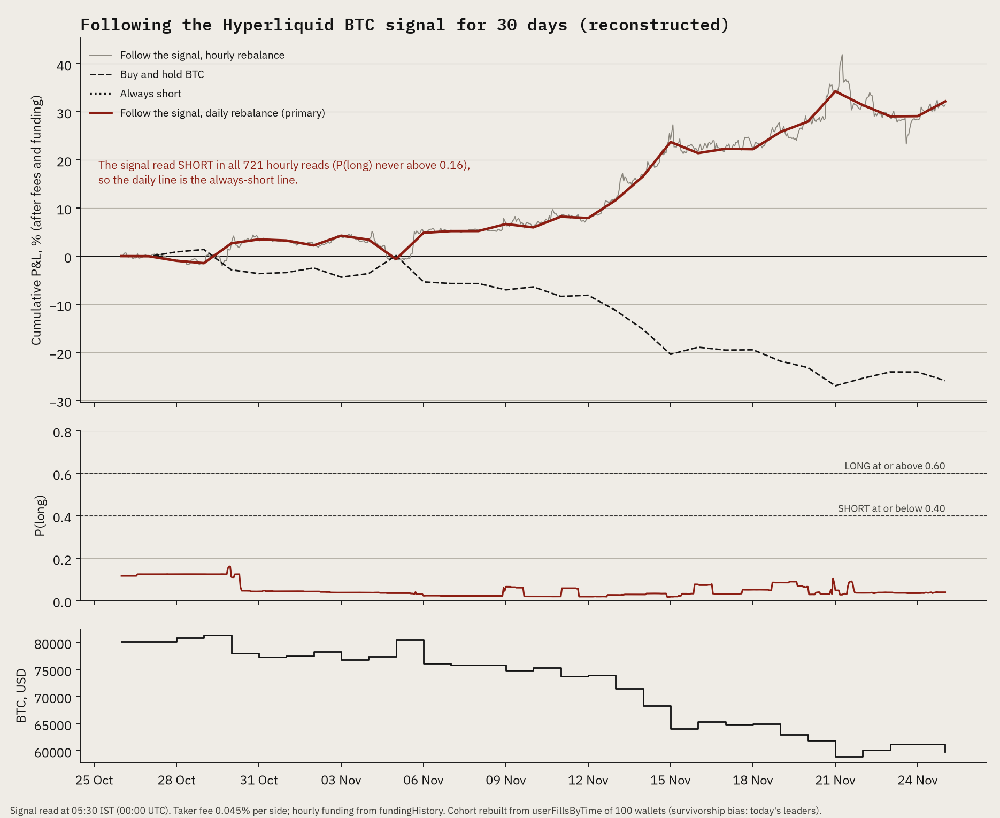

*Research note, 25 November 2026*

# Would following the Hyperliquid BTC signal for 30 days have made money?

**In one line:** the signal read SHORT in every hourly read of the last 30 days, so following it was the same trade as being short all month: **+32.2%** after fees and funding while BTC fell 25.4%. Profitable, but it is the trend, not evidence that the signal times turns.

| Rule, 30 days to 25 Nov 2026 05:30 IST | Return after fees and funding | Max drawdown |
| :--- | ---: | ---: |
| Follow the signal, daily | +32.2% | −4.7% |
| Always short | +32.2% | −4.7% |
| Buy and hold BTC | −25.9% | −28.0% |

Live site: [Backtest tab](https://prafullj0shi.github.io/hyperliquid-btc-signal/#backtest). Part of [hyperliquid-btc-signal](https://github.com/PrafullJ0shi/hyperliquid-btc-signal). Not financial advice.

## 1. Thesis

The live plate reads the aggregate Bitcoin positioning of the top 500 Hyperliquid traders ranked on one-month perp PnL, and turns it into one probability, $p_t$, that the weighted money is long. **The thesis under test: when that probability is far from one half, BTC tends to move the same way over the following period.** If it is true, holding the side the leaders hold should beat holding BTC and should beat a position chosen without looking at the leaders.

The test is built so that it can fail. A strategy that simply follows the signal will look good in any strong trend, so the reading has to be compared with the dumbest rule that earns the same trend: **always short** in a falling market, **always long** in a rising one. Only the part of the return that the signal adds on top of that rule counts as evidence of timing skill.

- **Null hypothesis.** Leader positioning has no timing value: following it does no better than the best constant position over the window.
- **Alternative.** Following it beats the best constant position after fees and funding, with position changes that were right more often than wrong.
- **What would count.** At least one signal change in the window, and a return above the constant position that earned the same trend.

## 2. Data and sources

Everything is public. No keys, no accounts, no private data. All requests go to `https://api.hyperliquid.xyz/info` (documented in the [Hyperliquid info endpoint reference](https://hyperliquid.gitbook.io/hyperliquid-docs/for-developers/api/info-endpoint) and the [perpetuals section](https://hyperliquid.gitbook.io/hyperliquid-docs/for-developers/api/info-endpoint/perpetuals)) except the leaderboard.

| Input | Source | Used for |
| :--- | :--- | :--- |
| Cohort | Public leaderboard `https://stats-data.hyperliquid.xyz/Mainnet/leaderboard` (no documentation page), then `portfolio` per wallet | Top 500 wallets by one-month perp PnL, with the live filters (equity at least USD 10,000, turnover at most 100) |
| Positions through time | `userFillsByTime`, one wallet at a time ([info endpoint](https://hyperliquid.gitbook.io/hyperliquid-docs/for-developers/api/info-endpoint)) | BTC position of each wallet at each signal time, rebuilt from the position before and after every BTC fill |
| Now-state | `clearinghouseState` | Account equity and the current BTC position (the anchor for wallets with no BTC fill in the window) |
| Price | `candleSnapshot`, BTC, 1 hour | Hourly open as the entry and exit price |
| Funding | `fundingHistory`, BTC ([funding rules](https://hyperliquid.gitbook.io/hyperliquid-docs/trading/funding)) | Hourly funding rate paid between longs and shorts |
| Fees | [Hyperliquid fee schedule](https://hyperliquid.gitbook.io/hyperliquid-docs/trading/fees) | Base-tier perp taker fee of 0.045% per side |
| Rate limit | [Rate limits](https://hyperliquid.gitbook.io/hyperliquid-docs/for-developers/api/rate-limits-and-user-limits) | 1,200 weight per minute per IP, enforced by the downloader |

The window is 26 Oct 2026 05:30 IST to 25 Nov 2026 05:30 IST: 30 daily steps, each read at 05:30 IST (00:00 UTC). Of the 500 cohort wallets, the 100 with the largest weight potential (log of month PnL times the equity shrink) were downloaded. 60 of them traded BTC in the window or hold BTC now.

## 3. Method

### 3.1 Rebuilding the signal in the past

The live sweep only stores snapshots from the day it was switched on, so a 30-day history has to be rebuilt. Each Hyperliquid fill carries the wallet's position before it (`startPosition`), its size and its side. The BTC position of wallet $i$ at time $t$ is therefore the position after the latest fill at or before $t$, where $\tau_{i,j}$ is the time of fill $j$, $z_{i,j}$ its size, and the sign is plus for a buy and minus for a sell:

$$
q_{i,t} = q^{\mathrm{after}}_{i,j^{*}}, \qquad j^{*} = \max\{\, j : \tau_{i,j} \le t \,\}, \qquad q^{\mathrm{after}}_{i,j} = q^{\mathrm{before}}_{i,j} \pm z_{i,j}
$$

A wallet with no BTC fill before $t$ but a later one takes the `startPosition` of its first fill in the window. A wallet with no BTC fill at all in the window keeps its current position. The API returns only part of the history for very active wallets, so those wallets are treated as unknown, and left out of $p_t$, before their earliest returned fill.

### 3.2 The live weights, applied to each past hour

The weights are exactly the live signal's. Here $\pi_i$ is one-month perp PnL in USD, $E_i$ account equity in USD, $q_{i,t}$ the signed BTC position and $B_t$ the BTC price.

$$
s_i = \ln\left(1 + \max\left(0,\ \pi_i\right)\right)
$$

$$
e_i = \min\left(1,\ \frac{E_i}{100000}\right)
$$

$$
c_{i,t} = \min\left(3,\ \frac{\left|q_{i,t}\right| B_t}{E_i}\right)
$$

$$
w_{i,t} = s_i \, e_i \, c_{i,t}
$$

Wallets with no BTC position do not vote. The probability that the weighted money is long, and the decision rule, are:

$$
p_t = \frac{\sum_{i:\, q_{i,t} > 0} w_{i,t}}{\sum_{i:\, q_{i,t} \neq 0} w_{i,t}}
$$

$$
\sigma_t = \begin{cases} +1 & p_t \ge 0.60 \\ -1 & p_t \le 0.40 \\ 0 & \text{otherwise} \end{cases}
$$

$\sigma_t = +1$ is long, $-1$ is short, $0$ is flat. The thresholds are the live ones. Note that $\pi_i$ and $E_i$ are today's values applied to every past hour, which is a source of bias (section 7).

### 3.3 Trading rule and costs

- **Position.** One unit of BTC perpetual, long, short or flat per $\sigma_k$, rebalanced to one unit of the account equity at every step. No leverage, no margin model.
- **Primary strategy.** One step per day: read $p_t$ at 05:30 IST, trade at the 00:00 UTC hourly open, hold 24 hours. Variants: every 4 hours and every hour.
- **Entry and exit price.** The hourly candle open. No slippage and no spread.
- **Fee.** $f = 0.00045$ per side on every change of position. A flip pays two sides. The only fee in the primary run is the opening trade.
- **Funding.** $\phi_h$ is the hourly funding rate of hour $h$. When $\phi_h > 0$ longs pay shorts, so a short earns it; the sign is carried by $\sigma_k$. The exchange applies the rate to notional at the oracle price; the backtest applies it to notional at the entry price, a small approximation.
- **Comparators.** Always short and buy and hold, with the same fee and funding, on the same steps.

For step $k$ from time $t_k$ to $t_{k+1}$, with $B_k$ the BTC price at the start and $\sigma_{k-1}$ the position held before the step ($0$ before the first step):

$$
r_k = \sigma_k \left( \frac{B_{k+1}}{B_k} - 1 \right) - f \left| \sigma_k - \sigma_{k-1} \right| - \sigma_k \sum_{h \in k} \phi_h
$$

$$
V_K = \prod_{k=1}^{K} \left( 1 + r_k \right), \qquad \mathrm{PnL}_K = V_K - 1
$$

### 3.4 Statistics

$$
\mathrm{MDD} = \min_{K} \left( \frac{V_K}{\max_{j \le K} V_j} - 1 \right)
$$

$$
\mathrm{HR} = \frac{\left| \{ k : \sigma_k \neq 0,\ \sigma_k R_k > 0 \} \right|}{\left| \{ k : \sigma_k \neq 0 \} \right|}, \qquad R_k = \frac{B_{k+1}}{B_k} - 1
$$

$$
S = \frac{\bar{r}}{s_r} \sqrt{N_{\mathrm{yr}}}
$$

$V_K$ is the equity multiple after $K$ steps and $\bar r$, $s_r$ are the mean and standard deviation of the step returns. $N_{\mathrm{yr}}$ is 365 for daily steps, 2,190 for 4-hourly and 8,760 for hourly. With 30 daily points the Sharpe-ish figure is not a reliable estimate; it is shown for completeness.

## 4. Results

Following the signal once a day for 30 days would have returned **+32.2%** after fees and funding, against **−25.9%** for holding BTC. The signal read SHORT at every one of the 721 hourly reads, with $p_t$ between 0.018 and 0.162, so it never traded again after opening a short.

| Strategy | Total return | Max drawdown | Trades | Hit rate | Sharpe-ish | Time in market |
| :--- | ---: | ---: | ---: | ---: | ---: | ---: |
| Follow the signal, daily (primary) | +32.2% | −4.7% | 1 | 53% | 7.6 | 100% |
| Follow the signal, 4-hourly | +31.8% | −10.1% | 1 | 53% | 6.7 | 100% |
| Follow the signal, hourly | +31.5% | −13.1% | 1 | 54% | 6.3 | 100% |
| Always short, daily | +32.2% | −4.7% | 1 | 53% | 7.6 | 100% |
| Buy and hold, daily | −25.9% | −28.0% | 1 | 47% | −7.6 | 100% |

*Table B1. Statistics for the 30 days to 25 Nov 2026 05:30 IST. Returns are after the 0.045% taker fee and hourly funding. Sharpe-ish is annualised.*



*Fig. B1. Cumulative P&L of each rule, and below it hourly P(long) against the 0.40 and 0.60 thresholds (the PNG adds the BTC price). The primary line lies on top of the always-short line because the position never changed.*

### 4.1 Day by day

| Day | Date (IST) | Signal | P(long) | Action | BTC entry | BTC next day | BTC move | Fees | Funding | Day P&L | Cumulative |
| ---: | :--- | :--- | ---: | :--- | ---: | ---: | ---: | ---: | ---: | ---: | ---: |
| 1 | 2026-10-26 | SHORT | 0.117 | open short | 80,109 | 80,111 | +0.00% | −0.045% | +0.025% | −0.02% | −0.02% |
| 2 | 2026-10-27 | SHORT | 0.125 | hold short | 80,111 | 80,889 | +0.97% | – | +0.030% | −0.94% | −0.96% |
| 3 | 2026-10-28 | SHORT | 0.125 | hold short | 80,889 | 81,319 | +0.53% | – | +0.030% | −0.50% | −1.46% |
| 4 | 2026-10-29 | SHORT | 0.125 | hold short | 81,319 | 77,948 | −4.15% | – | +0.030% | +4.17% | +2.65% |
| 5 | 2026-10-30 | SHORT | 0.113 | hold short | 77,948 | 77,338 | −0.78% | – | +0.025% | +0.81% | +3.48% |
| 6 | 2026-10-31 | SHORT | 0.044 | hold short | 77,338 | 77,534 | +0.25% | – | +0.030% | −0.22% | +3.25% |
| 7 | 2026-11-01 | SHORT | 0.045 | hold short | 77,534 | 78,326 | +1.02% | – | +0.030% | −0.99% | +2.23% |
| 8 | 2026-11-02 | SHORT | 0.044 | hold short | 78,326 | 76,805 | −1.94% | – | +0.030% | +1.97% | +4.24% |
| 9 | 2026-11-03 | SHORT | 0.039 | hold short | 76,805 | 77,434 | +0.82% | – | +0.030% | −0.79% | +3.42% |
| 10 | 2026-11-04 | SHORT | 0.039 | hold short | 77,434 | 80,478 | +3.93% | – | +0.017% | −3.91% | −0.63% |
| 11 | 2026-11-05 | SHORT | 0.036 | hold short | 80,478 | 76,078 | −5.47% | – | +0.030% | +5.50% | +4.84% |
| 12 | 2026-11-06 | SHORT | 0.024 | hold short | 76,078 | 75,835 | −0.32% | – | +0.030% | +0.35% | +5.20% |
| 13 | 2026-11-07 | SHORT | 0.023 | hold short | 75,835 | 75,851 | +0.02% | – | +0.030% | +0.01% | +5.21% |
| 14 | 2026-11-08 | SHORT | 0.023 | hold short | 75,851 | 74,820 | −1.36% | – | +0.030% | +1.39% | +6.67% |
| 15 | 2026-11-09 | SHORT | 0.066 | hold short | 74,820 | 75,334 | +0.69% | – | +0.029% | −0.66% | +5.97% |
| 16 | 2026-11-10 | SHORT | 0.021 | hold short | 75,334 | 73,771 | −2.07% | – | +0.029% | +2.10% | +8.20% |
| 17 | 2026-11-11 | SHORT | 0.020 | hold short | 73,771 | 73,980 | +0.28% | – | +0.024% | −0.26% | +7.92% |
| 18 | 2026-11-12 | SHORT | 0.019 | hold short | 73,980 | 71,448 | −3.42% | – | +0.019% | +3.44% | +11.63% |
| 19 | 2026-11-13 | SHORT | 0.028 | hold short | 71,448 | 68,275 | −4.44% | – | +0.023% | +4.46% | +16.62% |
| 20 | 2026-11-14 | SHORT | 0.030 | hold short | 68,275 | 64,122 | −6.08% | – | +0.011% | +6.09% | +23.72% |
| 21 | 2026-11-15 | SHORT | 0.019 | hold short | 64,122 | 65,330 | +1.88% | – | +0.024% | −1.86% | +21.42% |
| 22 | 2026-11-16 | SHORT | 0.077 | hold short | 65,330 | 64,858 | −0.72% | – | +0.020% | +0.74% | +22.32% |
| 23 | 2026-11-17 | SHORT | 0.031 | hold short | 64,858 | 64,921 | +0.10% | – | +0.024% | −0.07% | +22.23% |
| 24 | 2026-11-18 | SHORT | 0.052 | hold short | 64,921 | 63,037 | −2.90% | – | +0.026% | +2.93% | +25.81% |
| 25 | 2026-11-19 | SHORT | 0.086 | hold short | 63,037 | 61,962 | −1.71% | – | +0.013% | +1.72% | +27.98% |
| 26 | 2026-11-20 | SHORT | 0.066 | hold short | 61,962 | 58,923 | −4.90% | – | +0.010% | +4.92% | +34.27% |
| 27 | 2026-11-21 | SHORT | 0.049 | hold short | 58,923 | 60,183 | +2.14% | – | +0.002% | −2.14% | +31.40% |
| 28 | 2026-11-22 | SHORT | 0.037 | hold short | 60,183 | 61,249 | +1.77% | – | −0.002% | −1.77% | +29.07% |
| 29 | 2026-11-23 | SHORT | 0.039 | hold short | 61,249 | 61,245 | −0.01% | – | +0.026% | +0.03% | +29.11% |
| 30 | 2026-11-24 | SHORT | 0.036 | hold short | 61,245 | 59,795 | −2.37% | – | −0.002% | +2.37% | +32.16% |

*Table B2. All 30 daily steps. The signal is read at 05:30 IST (00:00 UTC) on the date shown, and the position is held to 05:30 IST the next day. Fees and funding are as a percentage of equity. The figure version is [daily_table_30d.png](figures/daily_table_30d.png).*

The best day was 2026-11-14 (+6.09%) and the worst 2026-11-04 (−3.91%). The curve peaked on day 26 (2026-11-20, +34.27%) and gave back 2.1 points by day 30. The position made money on 17 of 30 days after costs, and was on the right side of the daily price move on 16 (53%): day to day, the direction is close to a coin flip, and the profit comes from the size of the down days.

## 5. Why the result looks like this

- **One regime.** BTC fell from 80,109 to 59,795 (−25.4%) in 30 days. In a one-way fall, any rule that is short throughout makes money. The test window contains no rebound large enough to challenge the signal.
- **The signal never changed its mind.** $p_t$ stayed between 0.018 and 0.162, below the 0.40 short threshold for 721 of 721 hours. Following it meant one trade, on day 1. Excess return over always short is 0.0 percentage points: the signal added nothing to the trend and took nothing away.
- **The cohort is a list of last month's winners.** The leaders are chosen by one-month PnL as of 25 Nov. A month in which BTC fell 25% rewards the traders who were short, so the cohort leans short by construction. Using it to trade the same month is circular (survivorship and hindsight, section 7).
- **Compounding.** Rebalancing a short to one unit each day compounds gains as the price falls: a simple price-only short earns +25.4%, the daily-rebalanced short +31.3% before costs. The extra 6.0 points are a property of the trade size rule, not of the signal.
- **Funding paid the short.** Funding was positive in 643 of 720 hours, so longs paid shorts: +0.67% summed over the window. Fees cost −0.045%, one entry. Together they move the result by less than one point.
- **The Sharpe-ish figure is large for the wrong reason.** A steady one-way bet in a trend has a high mean-to-deviation ratio over 30 days; the same bet in a rising month would have a large negative one.

The compounding gap in the fourth point is the difference between the two quantities below, with $R_k$ the daily BTC return and $B_K / B_0$ the price ratio over the window:

$$
V^{\mathrm{short}}_K = \prod_{k=1}^{K} \left( 1 - R_k \right) \quad \text{versus} \quad -\left( \frac{B_K}{B_0} - 1 \right)
$$

## 6. Robustness checks

Three checks on whether the always-short reading is an accident of how the cohort was rebuilt, and one check on whether $p_t$ leads the price at all. The last uses the correlation between the 24-hour change in $p_t$ and the next 24-hour BTC return:

$$
\rho = \mathrm{corr}\left( p_t - p_{t-24},\ \frac{B_{t+24}}{B_t} - 1 \right)
$$

- **Complete wallets only.** Using only the 53 wallets whose fills cover the whole window, $p_t$ ranged from 0.027 to 0.206. It was below 0.40 in every hour, so the truncated wallets do not cause the always-short reading.
- **Weights removed.** Counting wallets instead of weighting them, the long share of voting wallets ranged from 0.05 to 0.18 at the daily reads. The cohort leaned short however it is counted.
- **Lead check.** Over 673 overlapping hourly points, $\rho$ is +0.08 for the change in $p_t$, and +0.06 between the level of $p_t$ and the next return. Both are small, and the points overlap so the effective sample is about 30. They give no sign of a lead.
- **Hourly and 4-hourly variants** give the same answer for the same reason: +31.5% and +31.8%, with a larger drawdown (−13.1% and −10.1%) from intraday swings.

## 7. Caveats and biases

- **Survivorship and hindsight.** The wallets are today's leaders, and their weights use today's month PnL and equity for every past hour. Traders who were short and right are over-represented; traders who were long and liquidated are not in the leaderboard. The bias is upward and large, and it points in the direction the market went.
- **Partial history.** For 47 of the 100 wallets the API returned only recent fills, so before their earliest returned fill they are unknown. The number of covered wallets ranged from 57 to 100 and the voters from 22 to 44 per hour. Early days rest on slower traders.
- **One fifth of the cohort.** 100 of the 500 wallets, chosen by weight potential. The live signal uses all 500.
- **Reconstruction, not snapshots.** Positions come from fills, not from stored `clearinghouseState` snapshots. Liquidations, auto-deleveraging, transfers and sub-account moves are not seen unless they appear as fills.
- **One window, one regime, one trade.** Thirty days, one direction, one position change. There is no out-of-sample period, no estimate of how often the signal flips, and no information about what it does at a turn.
- **Execution.** Hourly candle open prices, no slippage or spread, a base-tier taker fee, one unit of equity, no margin or liquidation risk, funding applied to entry notional.
- **Not financial advice.** This is a description of a historical window.

## 8. Verdict

> **Profitable on paper, not evidence of an edge.** Over the 30 days to 25 Nov 2026 05:30 IST the signal would have made +32.2% after fees and funding (maximum drawdown −4.7%), while BTC fell 25.4% and holding lost 25.9%. But the signal read SHORT in all 721 hourly reads, so the strategy is the always-short strategy: the same +32.2%, to the decimal. Almost all of the return is the downtrend. This window cannot show whether the signal calls turns, because it never had to. A fair test needs a cohort fixed before the window and a window that contains a reversal. The live site now logs $p_t$ every 30 minutes (`data/history.json`) for exactly that forward test; repeat this analysis on that log once it spans a turn.

## 9. Reproduce

```sh
# from the repository root
pip install -r requirements.txt matplotlib
python research/backtest-30d/scripts/analyze.py   # data/*.csv, results.json, series.json from the committed inputs
python research/backtest-30d/scripts/extra.py     # robustness checks -> data/extra.json
python research/backtest-30d/scripts/plot.py      # figures/*.png
# only if you want to re-download (about 40 minutes at 1,200 weight/minute; covers a newer window):
python research/backtest-30d/scripts/fetch.py
# rebuild this note and the site's Backtest tab (needs Node for MathJax only when a formula changes):
(cd research/backtest-30d && npm install) && python research/backtest-30d/scripts/build_docs.py
```

`analyze.py` is deterministic: the committed `data/market.json` and `data/wallet_paths.json` reproduce every number above. A fresh `fetch.py` covers the 30 days before the day you run it, and Hyperliquid serves only recent fills, so it cannot re-create this exact window later.

## 10. Files

Everything is in [research/backtest-30d](.). On the site, this page is the Backtest tab.

| File | Contents |
| :--- | :--- |
| [`data/daily_backtest.csv`](data/daily_backtest.csv) | Table B2 as CSV |
| [`data/hourly_signal.csv`](data/hourly_signal.csv) | The 721 hourly reads of $p_t$ with covered wallets and voters |
| [`data/results.json`](data/results.json) | Every statistic in Table B1, all variants, and the decomposition |
| [`data/series.json`](data/series.json) | Per-step rows and equity curves for the daily, 4-hourly and hourly runs |
| [`data/extra.json`](data/extra.json) | Robustness checks |
| `data/market.json`, `data/observed.json`, `data/wallet_paths.json` | Inputs: BTC candles and funding, cohort weights, rebuilt position paths |
| [`figures/equity_curve_30d.png`](figures/equity_curve_30d.png), [`figures/daily_table_30d.png`](figures/daily_table_30d.png) | Fig. B1 and Table B2 as images |
| `scripts/` | `fetch.py`, `analyze.py`, `extra.py`, `plot.py`, `build_docs.py` |

This is a description of a historical window, built from public data. It is not financial advice and not a forecast. Do not trade on it.

